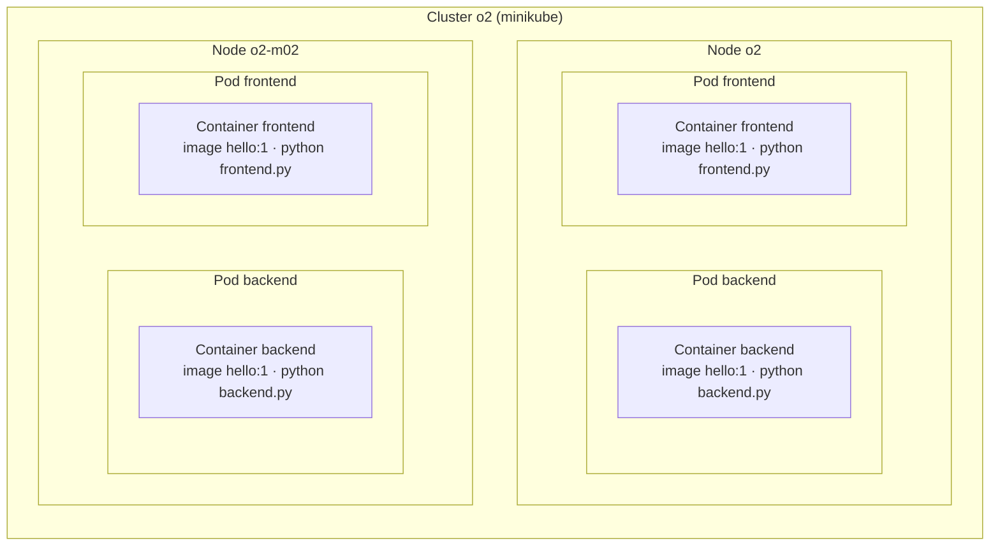

# Part 2 – Kubernetes

A hello-world app of two parts on a two-node cluster: the **frontend** calls the **backend** for every request and
shows which pods and nodes answered.



- **cluster** – two nodes managed as one; you say what should run (`app.yaml`), Kubernetes decides where,
- **node** – one machine (here a Docker container started by minikube); `o2` also runs the control plane,
- **pod** – the unit Kubernetes places on a node, with its own IP; backend and frontend have 2 pods each, one per
  node – if a node goes down, the other one still runs the whole app,
- **container** – the running app from the image `hello:1`; one container per pod here.

How the parts talk to each other (Services) is described in [Deploy](#deploy).

## Cluster

minikube with two nodes (control plane `o2` + worker `o2-m02`), Docker driver:

```bash
minikube start -p o2 --nodes 2 --driver docker --cpus 2 --memory 2g
kubectl get nodes      # o2 (control-plane), o2-m02
```

(`kubectl` can be `minikube -p o2 kubectl --`.)

## Deploy

```bash
docker build -t hello:1 .
minikube -p o2 image load hello:1      # copy the image to both nodes (no registry needed locally)
kubectl apply -f app.yaml
kubectl get pods -o wide               # one backend and one frontend pod on each node

curl http://$(minikube -p o2 ip):30080/
# frontend frontend-66bf48498c-fdfm4 on o2-m02
#   -> backend backend-84d68d56bf-cpdmk on o2 (v1): Hello from the backend
```

The request may go to the IP of either node: kube-proxy forwards NodePort traffic to one of the two frontend pods,
on this node or the other one. The frontend calls `http://backend:8000`: cluster DNS gives the Service IP and the Service picks one
of the backend pods (by the label `app: backend`), so repeated requests alternate between the two nodes.

How the requirements are met (`app.yaml`):

- **components on multiple nodes** – backend and frontend `replicas: 2` each with `topologySpreadConstraints` over
  `kubernetes.io/hostname` (max. 1 pod difference between nodes) → one pod of each per node,
- **parts communicate** – frontend → `Service backend` (`ClusterIP`, internal only); only the frontend is exposed
  (`NodePort` 30080),
- **rolling update** – `maxSurge: 1`, `maxUnavailable: 0` and a `readinessProbe` (see below).

## Rolling update (Figure 2)

```bash
docker build -t hello:2 --build-arg VERSION=2 .
minikube -p o2 image load hello:2
kubectl set image deploy/backend backend=hello:2   # in a real pipeline: new tag in app.yaml + apply
kubectl rollout status deploy/backend
kubectl rollout undo deploy/backend                # back to v1 if something goes wrong
```

### Live demo

```bash
./demo.sh
```

[`demo.sh`](demo.sh) creates or starts the 2-node cluster if needed, builds and loads the images `hello:1` and
`hello:2` if missing, waits for the cluster DNS, resets the
backend to v1 and opens 3 terminals (`gnome-terminal`):

| Terminal | Shows |
|---|---|
| 1 · requests | a request every 0.3 s – which backend pod, node and version answered, `FAILED` on an error |
| 2 · backend pods | `kubectl get pods -l app=backend -o wide -w` – pods appearing, becoming ready, terminating; one colour per version (blue = v1 at the start, green = the new one) |
| 3 · rolling update | an empty shell – start the update here |

In terminal 3 run:

```bash
kubectl set image deploy/backend backend=hello:2
```

Terminal 2 shows one new pod start, turn `1/1` (ready) and only then one old pod terminate – twice. Terminal 1
switches from `(v1)` to a mix of `(v1)`/`(v2)` and then only `(v2)`, with no `FAILED`. Back to v1, also without
downtime: `kubectl rollout undo deploy/backend`. Running `./demo.sh` again starts over from v1.

What Kubernetes does, pod by pod:

1. starts **one new pod** (v2) next to the two old ones (`maxSurge: 1`),
2. waits until its `readinessProbe` (`GET /healthz`) passes – only then the Service sends it traffic,
3. stops **one old pod** – never before a new one is ready (`maxUnavailable: 0`); the old pod gets SIGTERM, the
   Service stops routing to it,
4. repeats until all pods run v2. During the update both versions answer; afterwards only v2.

Measured on this cluster: requests every 0.1–0.2 s during 7 updates – **0 failed** out of 990. With the final
`app.yaml` the two new pods always ran on different nodes and the old pods were gone ~5 s after the update.

Two details found by that test:

- `matchLabelKeys: [pod-template-hash]` – without it the spread counts old and new pods together: when the old
  pods were leaving, both new pods landed on the same node,
- `signal.signal(SIGTERM, …)` in the apps – Python as PID 1 ignores SIGTERM, so each old pod waited the full 30 s
  grace period before being killed.

## Questions

### What are the basic parts of a Kubernetes cluster?

**Control plane** – decides what should run where:

- **kube-apiserver** – the only entry point (kubectl, CI, the other components); validates and stores objects,
- **etcd** – key-value store with the whole cluster state (the desired state from the manifests + the current state),
- **kube-scheduler** – picks a node for each new pod (resources, constraints such as the spread above),
- **kube-controller-manager** – control loops that keep the current state equal to the desired one: e.g. the
  ReplicaSet controller creates a new pod when one disappears, the Deployment controller runs rolling updates,
- (cloud-controller-manager – load balancers, disks, nodes of a cloud provider, e.g. in AKS).

**Nodes** – run the pods:

- **kubelet** – the agent on every node: starts the containers of the pods scheduled to its node, runs the probes,
  restarts crashed containers, reports to the API server,
- **container runtime** – runs the containers (containerd here),
- **kube-proxy** – implements Services on the node (iptables/IPVS rules from the Service IP to the pod IPs).

**Main objects** used here: **Pod** (one or more containers with one IP, always on one node), **Deployment** (desired
number of pod replicas + update strategy, manages ReplicaSets), **Service** (stable name and IP in front of pods
selected by labels; `ClusterIP` internal, `NodePort`/`LoadBalancer` from outside). Others: Namespace, ConfigMap,
Secret, Ingress, PersistentVolume.

### How does Kubernetes differ from Red Hat OpenShift?

OpenShift is Red Hat's **Kubernetes distribution** – Kubernetes inside, plus what a company otherwise assembles
itself. Manifests like `app.yaml` work on both; `oc` CLI is a superset of `kubectl`.

| | Kubernetes | OpenShift |
|---|---|---|
| What it is | open-source core, many distributions (AKS, EKS, GKE, minikube) | commercial product with Red Hat support (also on Azure as ARO) |
| Security by default | permissive – containers may run as root | strict – Security Context Constraints: no root, random UID (this image runs as `nobody`, so it works there) |
| Exposing apps | Ingress (controller installed separately) | Routes + built-in router |
| Build & registry | none – external CI and registry | built-in: BuildConfig, Source-to-Image, internal registry, ImageStreams |
| Web console, users | Dashboard optional, auth external | full web console, built-in OAuth, Projects (namespaces with access control) |
| Extras | choose and install yourself | monitoring, logging, OperatorHub, Pipelines (Tekton), GitOps (Argo CD) included |
| Nodes, upgrades | any OS, upgrades up to you | Red Hat CoreOS, cluster upgrades managed by operators |

In short: Kubernetes is the engine, OpenShift a complete platform built on it – more opinionated and secure out of
the box, at the price of licences and less freedom.

### How would the application get from the repository to the cluster?

Locally above by hand: `docker build` → `minikube image load` → `kubectl apply`. In production a pipeline does the
same on every merge to `main`, e.g. in Azure:

1. **CI** (GitHub Actions / Azure DevOps): tests → `docker build` → tag with the git commit SHA (never `latest` –
   every version is traceable and can be rolled back) → push to a registry (**Azure Container Registry**),
2. **CD** – the new tag gets into the cluster (**AKS**, pulling from ACR via managed identity), either
   - **push**: the pipeline runs `kubectl apply` / `helm upgrade` with the new tag, or
   - **GitOps** (preferred): the pipeline only commits the new tag to a config repo; **Argo CD** or **Flux** in the
     cluster sees the change and applies it – the repo is the single source of truth, rollback = `git revert`,
3. the change of the image tag in the Deployment starts the **rolling update** above; `kubectl rollout status` (or
   Argo CD health) tells the pipeline whether it succeeded.

Environment-specific values (replicas, URLs) via Helm values or Kustomize overlays per dev/test/prod; secrets from
Azure Key Vault, not from the repo.

### How would a rolling update be realized?

See [Rolling update](#rolling-update-figure-2) above: a new image tag in the Deployment → Kubernetes replaces the pods
one by one (`maxSurge`/`maxUnavailable` set the pace), a new pod gets traffic only after its readiness probe passes
and an old one is stopped only after that. Pods on different nodes are thus updated one after another and the app
keeps answering all the time. If the new pods never become ready, the rollout stops with the old pods still serving;
`kubectl rollout undo` returns to the previous version.

## Clean up

```bash
kubectl delete -f app.yaml
minikube delete -p o2
```
